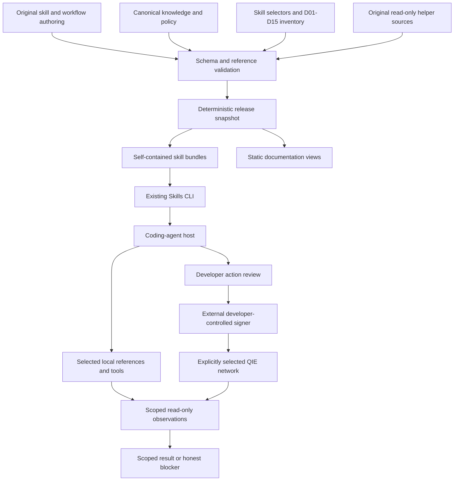

# QIE Forge Architecture

**Status:** architecture contract for the implemented B02–B08 foundation plus the B09 local distribution, update and rollback slice. B09 remains PARTIAL for remote/public distribution. It describes component boundaries, artifact ownership and acceptance requirements. It does not certify live QIE capabilities, public distribution or production readiness.

**Requirements authority:** [QIE Forge PRD v2.1](../QIE_Forge_PRD_v2.1.md). Implementation decisions are recorded in [decisions.md](decisions.md). Engineering acceptance contracts are recorded in [engineering-quality.md](engineering-quality.md). The canonical domain inventory is [source-map.md](source-map.md).

## 1. Purpose and product boundary

QIE Forge is a files-first, agent-agnostic knowledge and workflow system for developers building on QIE. It provides task routing, scoped network and ecosystem knowledge, original recipes, and small read-only diagnostics. It is not a hosted runtime, a model provider, a wallet, a chain indexer or a deployment service.

The product must remain useful when a coding agent can read only an installed skill directory. Every installable skill therefore carries its own entry instructions, selected references, data snapshots, manifests and helper import closure. A checkout, repository root or sibling skill is never a runtime dependency.

## 2. System components and trust boundaries

The build tool reads canonical sources; generated files are never an input truth. A static documentation surface presents released content but does not modify installed skills. The coding-agent host and the developer's signer own permissions and execution authority. QIE networks and external sources remain outside the Forge trust boundary.

The baseline deliberately excludes a custom product CLI, MCP server, database, Build Registry, RAG service, LLM service, login system and required hosted backend. A later need for any of these requires a concrete requirement and an explicit decision record.

## 3. Repository ownership

| Location | Owns | Must not become |
|---|---|---|
| `authoring/<skill>/SKILL.md.in` and local references | Purpose, triggers, decision tree, procedures, interpretation and failure branches | A second copy of canonical QIE facts |
| `knowledge/` | Sources, claims, capabilities, addresses, validation runs, domains, skill selectors and policy | Narrative skill prose or generated output |
| `knowledge/schema/` | Strict JSON Schema 2020-12 contracts, required keys, nullability and enums | An implicit migration layer |
| `recipes/` | One canonical home for reusable cross-domain procedures and their assets | A per-skill duplicate procedure |
| `scripts/` | Contributor build, validation and small optional read-only helpers | A product runtime or an installed dependency |
| `release-context.json` | Frozen release and schema versions plus the release-cut timestamp | A source-review timestamp or live evidence |
| `dist/skills/<skill>/` | Generated staging output | A manually edited source tree |
| `skills/<skill>/` | Generated, publishable, installer-visible bundles with manifests | A second editable truth |
| `tests/` | Contract, unit, packaging, negative-path and installation fixtures | A substitute for live evidence |
| `docs/` | Architecture, decisions, results and provenance records | A source of canonical facts |

Generated Markdown is marked `DO NOT EDIT`. Generated executable helpers retain valid comments, and generated JSON records provenance through the manifest. Manual edits belong in `authoring/`, `knowledge/`, `recipes/` or `scripts/`, followed by a deterministic rebuild.

## 4. Catalogue and router contract

`knowledge/skills.yaml` is the single skill catalogue. Each entry records the skill ID, source entry, release tier, release selector, domain bindings, intent tags, logical handoffs, knowledge selectors, recipes and helper paths. Published inventory is derived from entries enabled for the release; the initial P0 count is not a hard-coded expansion limit.

The router prose is authored, but the route and coverage references are generated from the catalogue. There is no dynamic routing service. A routing result should identify:

- the selected intent or domain;
- the selected network, or the missing input that prevents selection;
- EVM or native execution context;
- the minimal useful skill and reference set;
- required artifacts and evidence constraints;
- the next safe action.

Clarification is requested only for consequential missing inputs. A conceptual question must not demand a wallet, signer or deployment. Cross-skill handoffs use logical skill names, never sibling filesystem paths.

Publication state is derived from the catalogue, not from a domain mentioning a skill:

- **published in this release** — installable; it may still be missing locally;
- **catalogued; not published in this release** — not installable from this release;
- **planned; not a published artifact** — not installable and never offered as a release artifact.

A published-but-missing skill may receive a same-source installation remedy. A planned or unpublished skill must be declared non-installable, with no fabricated install command and no broken local link.

## 5. Progressive disclosure and workflow contract

| Level | Content | Loading rule |
|---|---|---|
| Discovery metadata | Name, description and relevant compatibility boundary | Enough for the host to recognize relevance |
| Entry `SKILL.md` | Inputs, decision tree, outputs, trust/action boundary, reference map | Read when the skill is activated; no full catalogue dump |
| References and recipes | Procedure, constraints, scoped facts, unsupported cases | Select only what the task needs |
| Data and helpers | Structured snapshots and local read-only tools | Use only when the answer or check requires them |
| External primary source | Official URL and provenance | Fetch when needed; treat content as untrusted data |

A workflow declares its inputs, prerequisites, producer/consumer artifacts, permitted action class, expected observation, failure branches and continuation rule. One recipe owns orchestration; topical skills provide narrow procedures and explicit handoffs. A local ABI or fixture may support frontend work before an approved deployment, but a live address enters configuration only after its evidence gate is satisfied.

The development path follows the PRD state machine. Simple discovery tasks may finish with a grounded answer; they are not forced through build, deploy and verify. `AWAITING_USER_APPROVAL`, `PENDING`, `UNKNOWN` and `REORG_SUSPECTED` are not completion states. Approval text is not proof that a signer approved a transaction.

## 6. Canonical knowledge contract

The canonical entities are Source, Claim, ToolCapability, AddressRecord and ValidationRun. Their serialized field names follow PRD §9.2. Each entity carries the identity, scope, evidence, status, timestamps, maintainer and limitation fields required by its schema.

| Entity | Required identity and scope |
|---|---|
| Source | `source_id`, URL, title, publisher, trust tier, reviewed timestamp, license, network scope, maintainer |
| Claim | `claim_id`, subject, predicate, value, `network_id`, sources, status, evidence type, test IDs, check/expiry, maintainer, risk and version scope |
| ToolCapability | `capability_id`, tool, operation, network IDs, version scope, status, evidence/test IDs, check/expiry, recipe path and limitations |
| AddressRecord | Chain and address identity, claimed product, issuer/ABI provenance, code observation, status and check metadata |
| ValidationRun | Test ID, scope, tool version, network, expected/observed result, outcome, timestamp, artifact hash, redacted log reference and reviewer |

The canonical status enum is exactly `VERIFIED`, `DOCUMENTED`, `CLAIMED`, `UNKNOWN`, `CONFLICTED`, `STALE`, `UNSUPPORTED` and `DEPRECATED`. Evidence types and validation-run outcomes are separate enums. Absence of evidence is `UNKNOWN`, never an inferred negative; `UNSUPPORTED` requires explicit negative evidence.

`VERIFIED` promotion requires sources, explicit validity, reviewed non-mock PASS evidence, matching network, operation and exact tool version, matching expected and observed results, and, for claims, equality to the claimed value. A record's freshness cannot start after the check that supports it. Code presence never proves issuer identity, ABI correspondence or product ownership.

Authored prose uses canonical IDs and build-time placeholders for risky QIE values such as chain configuration, endpoints and support verdicts. Hand-written canonical facts are rejected by the build guard. This reduces duplication; it does not prove that every source statement is true.

**Address identity blocker.** No ecosystem contract may be promoted to `VERIFIED` until issuer provenance, ABI provenance, a scoped `(chain_id, address)` identity observation, human review and conflict handling exist. An explorer page, a successful receipt or non-empty bytecode is not sufficient. The canonical address collection remains empty until that gate is satisfied.

## 7. Effective freshness and status projection

`scripts/lib/effective-status.mjs` is the single pure evaluator. It receives a record, the frozen policy, an evaluation clock and the access/check context. It never fetches the network, edits the record or promotes status.

The rules are:

1. Authoritative conflict in the same scope overrides positive evidence.
2. A stored `VERIFIED` record past `expires_at` projects to `STALE`. Publication or build time never extends validity.
3. Missing or unusable clock, future check metadata or offline high-risk evidence cannot produce a fresh `VERIFIED`; report `UNKNOWN` with the reason, or `STALE` when expiry is already established.
4. A reachable URL, a successful build or a helper exit code never promotes `UNKNOWN` or `CLAIMED` to `VERIFIED`.
5. Deprecation and unsupported states require evidence; recovery requires reviewed revalidation, not an automatic label change.

The immutable snapshot stores historical values. Every developer-facing view publishes the stored value and the effective value side by side, explicitly labelled, using the same frozen evaluation clock. A release cannot show one verdict in the catalogue and a different verdict in the compatibility matrix or an installed snapshot.

## 8. Deterministic packaging and manifests

The build flow is:

1. Validate sources, schemas, policy and catalogue.
2. Materialize only the selected entry, references, data snapshots, recipes, helpers and import closure.
3. Copy recipe trees with their relative paths; do not rely on a checkout-relative reference.
4. Resolve local links and reject escaping paths, missing files, broken imports and symlinks.
5. Emit `MANIFEST.json` with per-file SHA-256 entries.
6. Compare regenerated bytes with the published tree under `--check`.

A manifest records the skill ID, release version, schema version, frozen `built_at`, derived `sources_checked_at`, knowledge and policy digests, a content-addressed suite `release_id`, and the sorted file list with hashes. The manifest does not hash itself. Same inputs and release context must produce equal bytes across separate build roots. The release identity hashes every non-manifest file in every published bundle plus the release version, schema version and frozen build timestamp; it is shared by all nine bundles from one release cut and changes when any covered byte changes.

`built_at` comes from frozen `release-context.json`, not from wall-clock time during a build. `sources_checked_at` is the oldest review timestamp among bundled sources, or null when reviews are incomplete. A release-cut chronology gate compares `built_at` and every source review timestamp with the real build clock, with a documented clock-skew tolerance; an unknown review time stays null and the dependent operation stays conservative.

## 9. Installation, updates, rollback and static distribution

The existing Skills CLI is the installation contract. The published suite is discovered from `skills/<skill>/SKILL.md`; `--skill '*'` selects the suite and `--skill <name>` selects one self-contained skill. Single-skill installation must survive removal of the source checkout and must not depend on a sibling skill.

A tagged or full-commit-SHA ref is the reproducibility and rollback unit. The lock records the requested ref; `skills update` advances a mutable branch but leaves a pinned tag or SHA unchanged. Cross-skill workflows compare `release_id`, release version and schema version before combining procedures. Mixed or incompatible releases are rejected by the read-only verifier and require explicit remediation.

The pinned CLI does not validate bundle manifests during install or update. B09 therefore adds `scripts/verify-installed-release.mjs`, which recomputes file hashes and the suite identity after installation, reports legacy manifests, mixed releases and schema mismatches, and exits fail-closed. This is a verifier, not a Forge installer or updater.

Observed CLI limits are documented rather than hidden: local-directory sources are install-only and `skills update` exits 0 without updating them; `skills update` does not preserve a prior `--copy` projection for Claude Code; and rollback is an explicit reinstall of a known-good immutable ref. Copy-mode fidelity after update or rollback therefore requires an explicit `--copy` reinstall.

A future static documentation surface must serve byte-identical released Markdown/JSON under versioned paths, preserve relative links and publish the same effective-status projection as the installed bundle. It must not become a second factual catalogue. B09 exercises local smart-HTTP Git and one authenticated private GitHub source at an immutable SHA; it does not prove public Git-source installation or a public-release claim.

## 10. Tooling and dependency budget

| Decision | Reason | Limit |
|---|---|---|
| Node.js ESM for build, validation and helpers; one npm lockfile | One portable toolchain for content compilation and local checks | Exact Node, npm and dependency versions must be pinned and tested |
| YAML for canonical data; JSON for schemas, snapshots and manifests | Human review plus strict machine validation | No additional configuration format; no implicit migration |
| `yaml` for parsing | Strict duplicate-key handling and clear errors | Build dependency only; installed helpers consume JSON |
| `ajv` and `ajv-formats` | JSON Schema 2020-12 validation of enums, timestamps and URIs | No coercion or default mutation |
| Node built-in test runner and mock fixtures | Contract and negative-path tests without another framework | Mocks remain `MOCK` evidence, not provider support |
| Static HTML/Markdown/JSON when B10 starts | Browsable and raw release content without an application runtime | No backend, database or per-request filesystem service |
| GitHub Actions plus a static host/CDN when publication starts | Reviewed release logs and immutable file distribution | Hosting vendor is not selected; no secret is needed to read skills |

The custom scripts in this repository are contributor tooling, not a new product CLI. No package registry, MCP server, backend API, database, RAG system, LLM service or login is part of the baseline.

## 11. Read-only helpers and proof boundaries

Helpers read packaged JSON snapshots and policy, use bounded requests and return structured results. Timeouts, response-size limits and retry policy are validated configuration, not hidden defaults. Error classes follow the PRD. Runtime observations are separate from capability status.

- The network preflight verifies the expected chain and block responsiveness on one explicitly selected network. It never fails over to the other network.
- The transaction observer verifies request/receipt identity, block fields, target/created-contract shape and canonical status. Malformed data is `RPC_MALFORMED` or `UNKNOWN`, never PASS.
- A code read at `latest` is not inclusion-block code and never proves issuer identity.
- `APPLICATION_VERIFIED` requires every scoped check plus an established finality policy. While QIE finality is unresolved, the result remains `UNKNOWN` or a limited observation at a named block.
- No helper signs, broadcasts, stores keys or expands diagnosis into publishing, login or spending.

## 12. Validation and governance

| Layer | Demonstrates | Failure treatment |
|---|---|---|
| Authoring/spec | Valid frontmatter, directory/name agreement, original source and supported reference structure | Pull request fails |
| Knowledge/policy | Strict schemas, shared enum, scope/evidence linkage, negative evidence and current validity | Critical trust or promotion is blocked |
| Build/determinism | Same inputs and context produce the same files and hashes; edited generated output is detected | Publication is blocked |
| Package isolation | Suite, single and partial installs; copy and symlink modes; source/cache removed; offline references and mocked helpers still work | Distribution gate fails |
| Status parity | Frozen-clock fixtures across installed snapshots and views, including unknown clock and expired records | Developer-facing verdict is blocked |
| Routing/host | Accepted route sets and forbidden substitutions, reported per host/model/version | Broad compatibility claim is blocked |
| Recipes/tools | Clean fixture build, pinned commands and error branches | Recipe is not labelled verified runnable |
| Chain/action | Negative evidence, identity/effect/reorg/finality handling and approved live checks | Mainnet or application claim is blocked |
| Documentation | Raw bundle parity, effective status, routes, links and accessibility | Documentation release is incomplete |
| Developer value | Consented baseline, failures, interventions and PRD thresholds | Continue, narrow or stop expansion |

Release CI is separate from live-source, link and RPC probes so a transient network outage cannot make offline contracts nondeterministic. A failed probe is recorded as `UNKNOWN`; it cannot turn a critical gate green through a silent skip. Maintainers adjudicate source and status changes. Automation may notify; it does not auto-publish.

Changes follow: edit source → run validators and build → inspect the generated diff → review source/evidence → release. High-risk address and status changes require maintainer review. Offline installations cannot be forced to accept a revocation; risk-based expiry and runtime preflight bound the exposure without claiming immediate global enforcement.

## 13. Milestone blueprint

The milestone table is a dependency plan, not an implementation claim. B02–B08 are represented by the current foundation; B09 is represented locally and remains PARTIAL for remote/public distribution; B10 and later remain future work.

| ID | Deliverable | Acceptance summary |
|---|---|---|
| B01 | Ownership, repository/license, scope and signing budget | Named accountable roles and a recorded scope decision |
| B02 | Source and domain inventory | D01–D15 have sources or explicit gaps, network scope and maintainers |
| B03 | Entity schemas, enum, policy and field reconciliation | Invalid, expired, conflicting and falsely promoted records are rejected |
| B04 | Thin packaging slice | Staging equals publication; manifests hash correctly; deterministic rebuild |
| B05 | Router, catalogue and coverage references | Full/partial install remediation; frozen accepted routes; no network substitution |
| B06 | Shared effective status and read-only diagnostics | Same rules on the same clock; explicit timeout/offline/malformed/wrong-chain handling |
| B07 | Operational skills and five core recipes | Versioned commands, preconditions, postconditions, bundled closure and negative paths |
| B08 | Ecosystem catalogue | Operation/network/version scope; unknown interfaces stay unknown; no invented address |
| B09 | Full-suite packaging and update/rollback matrix | Exactly nine P0 entries; suite and single installs; immutable refs; coherent rollback |
| B10 | Static documentation from the normalized release | Required routes, raw file parity, valid relative links and status parity |
| B11 | Reference app and scoped verifier fixtures | Local reproducible build; unrelated-success and wrong-target fixtures never verify |
| B12a | Controlled testnet proof | Actual transaction, contract and postcondition; unresolved finality stays limited |
| B12b | Mainnet demonstration | Scoped identity/effect/finality evidence; no unattended write |
| B13 | Host and model evaluation | Four-host discovery, two-host workflow, frozen routing thresholds |
| B14 | Consented external pilot | Independent completions, no critical wrong-chain or invented-address errors |
| B15 | Release candidate and known limitations | Complete gate evidence; same-tag artifacts; update/rollback documentation |
| B16 | Conditional contest submission | Organizer criteria and required artifacts are actually satisfied |

## 14. Open technical decisions

| ID | Open decision | Default and required evidence | What remains blocked |
|---|---|---|---|
| AT-01 | Final schema key/nullability reconciliation | Use PRD §9.2 entity names, keep §14.4 as the evidence-report contract, freeze schemas and valid/invalid fixtures | Schema freeze and publication format |
| AT-02 | Exact Node/package/Skills CLI versions and ref syntax | Resolved for the tested pin: suite/single, copy/symlink, tag/full-SHA install, update and rollback; public hosting remains untested | Public distribution compatibility claim, not local/private distribution |
| AT-03 | QIE confirmation/finality, block tags and reorg handling | Official network evidence plus scoped observations; unknown stays unknown | `APPLICATION_VERIFIED` and full live-proof claim |
| AT-04 | User-controlled wallet/signer and approval UX | Test account/network/transaction display and explicit signing without exposing keys | Live signing workflow and B12 |
| AT-05 | QIE provider/SDK/ABI/address candidates | Issuer/provider sources, exact version/network and operation-specific tests; no inherited assumptions from another chain | Capability promotion and P1 recipes |
| AT-06 | Risk-based expiry, request/retry/response and log-range policy | Maintainer policy plus representative fixtures; define null expiry and unavailable-clock behavior | Freshness or runtime reliability claim |
| AT-07 | Static hosting and publication settings | Prove raw Markdown/JSON MIME, immutable paths, relative references and cache/latest policy | Public documentation delivery claim |
| AT-08 | Reference app frontend/tool versions and source-verification path | Local build, wallet smoke test and a separate explorer verification capability | Reference workflow completeness |

Non-technical dependencies remain explicit: organizer eligibility (D-01) blocks B16, not foundation work; repository namespace, license, named owners, capacity and spend authority (D-02) block release publication and financial actions. No repository namespace or maintainer is invented.

## 15. What this document does not claim

This architecture does not claim a live QIE RPC check, wallet connection, transaction signature, broadcast, deployment, explorer verification or `VERIFIED` capability. It does not claim public Git-source installation, official Agent Skills validator success, remote B09 distribution, host/model evaluation or production readiness. Update, copy/symlink and rollback behavior is claimed only for the exact CLI, source type and ref matrix recorded in [B09 results](b09-results.md). Those are separate gates with their own evidence.
